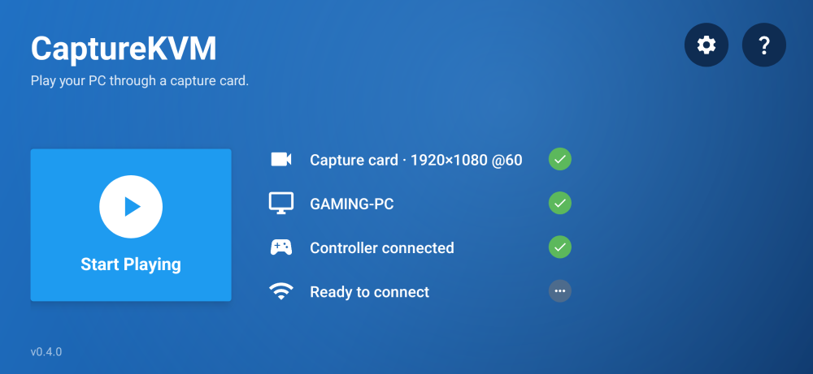
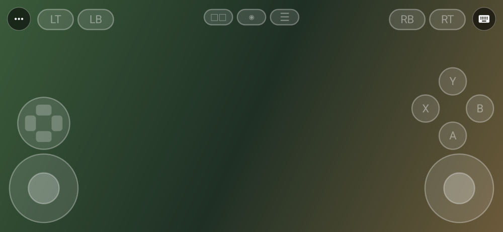
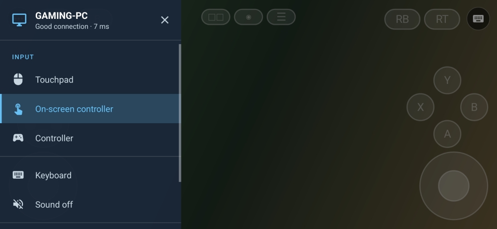

# CaptureKVM

Watch your PC through a USB capture card and drive it from the device the card is plugged into —
keyboard, mouse and **gamepad** — over [Beamer](https://github.com/kalkman-code/beamer)'s link.

```
                      HDMI cable                   USB-C / USB-A
  ┌───────────┐                   ┌─────────────┐                 ┌──────────────────┐
  │    PC     │ ── HDMI out ────▶ │ USB capture │ ──── UVC ─────▶ │ Windows laptop   │
  │           │                   │    card     │                 │   or Android     │
  │ CaptureKVM│                   └─────────────┘                 │    tablet        │
  │  "host"   │                                                   │ CaptureKVM, mode │
  │ ViGEmBus  │◀───── Wi-Fi / LAN, Beamer wire v6, TCP 24820 ─────│    "receiver"    │
  └───────────┘        keyboard · mouse · pad reports only        └──────────────────┘
```

**The video never touches the network.** It arrives down a cable as UVC frames, so the picture's
lag is the card's (roughly 60–100 ms for a cheap MS2109 grabber) and no encoder, no bitrate and no
Wi-Fi hiccup can touch it. Only input goes over the air, which is a few dozen bytes a frame.

That split is the whole point: streaming video over Wi-Fi *and* sending input back over the same
Wi-Fi gives you two sources of lag that interact. Here they are independent, and the one you feel
most — the picture — is wired.

## Download

Built binaries are on the [Releases](https://github.com/connexionlimodubai-pixel/capturekvm/releases)
page, not in the file tree — build output does not belong in a source repository.
`.github/workflows/release.yml` builds and attaches them when a `v*` tag is pushed.

| | |
|---|---|
| **Android** | `CaptureKVM-<tag>-android.apk` — sideload it. Debug-signed, so Android warns about an unknown source. |
| **Windows** | `CaptureKVM-<tag>-windows-setup.exe` — run it. It installs for your user only, needs no administrator permission, and asks which end of the link the machine is: see [The Windows installer](#the-windows-installer). Unsigned, so SmartScreen warns: *More info* then *Run anyway*. Releases up to 0.4.1 shipped a zip instead. |

The APK is one end only: it needs a PC running CaptureKVM in host mode, or stock Beamer without
the pad. The Windows installer is **both** ends — the same installer goes on the PC and on the
laptop.

To build them yourself:

```bash
cd android && ./gradlew :app:assembleDebug
```

```bash
cd windows && .\build.ps1 -Installer
```

`build.ps1` loads every module of both modes back out of the finished exe before it calls the
build a success. A windowed exe missing a module shows no window and says nothing, so there is no
other way to find out short of double-clicking it; `.\smoke.ps1` does that part, starting the
built exe in each mode and checking that a window with the right title appears. `-Installer`
then compiles `installer\CaptureKVM.iss` with Inno Setup 6, which has to be installed; without it,
`build.ps1` builds the app folder alone.

### The Windows installer

Per user, like Beamer's own: it installs to `%LOCALAPPDATA%\Programs\CaptureKVM` with no
administrator permission, adds *CaptureKVM* and *CaptureKVM - change mode* to the Start menu, and
uninstalls from Settings → Apps. Your pairings and settings stay in `%APPDATA%\CaptureKVM` across
an uninstall, so reinstalling keeps them.

It asks which end of the link the machine is — receiver, host, or ask when it starts — and on the
**PC being watched** it offers two things, each through Windows's own administrator prompt and
only when ticked:

- **Firewall rules** so the laptop or tablet can reach host mode: TCP 24820, UDP and TCP 24821,
  private networks only. They have CaptureKVM's own names, never Beamer's: Beamer's uninstaller
  removes its rules by name, so sharing a name with an old Beamer on the same PC would let either
  uninstall take the other's rules. Skipped, Windows asks the first time a laptop connects.
- **The ViGEmBus driver**, offered only when none is installed: Nefarius's signed MSI, for game
  controllers. A driver that is already there is never touched.

If an older Beamer is installed on the PC, the installer says so: close it before starting
CaptureKVM, or the two will both try to drive the controller.

Silent installs take `/VERYSILENT /ROLE=host|receiver|ask`, plus `/FIREWALL=0` and `/DRIVER=0` to
skip those. CI installs every release silently as a receiver on a clean machine, checks what landed,
and uninstalls it before anything is published.

## One exe, either end

One `CaptureKVM.exe` is both sides of the link. It asks once, per machine:

| | |
|---|---|
| **receiver** | The machine the capture card is plugged into. Shows the PC's picture, and sends it the keyboard, mouse and controller. |
| **host** | The PC being watched. Its HDMI goes out to the card and it takes the input back, the controller through a virtual Xbox pad. This mode is the Beamer fork's own window. |

The installer asks this on a page of its own; without an answer there, the app asks when it first
starts, and *Always start in this mode* stops it asking again. To change the answer later:
**CaptureKVM - change mode** in the Start menu, *Mode…* in the receiver's toolbar, or

```bash
CaptureKVM.exe --mode receiver    # skip the question
CaptureKVM.exe --mode host
CaptureKVM.exe --pick             # ask again, and forget the remembered answer
```

The mode is settled before Qt starts and only that half is imported, so a receiver never loads
the virtual-pad stack and a host never loads OpenCV. `--hidden`, `--config` and Beamer's other
arguments mean host mode on their own: Beamer relaunches itself with them for administrator mode
and runs itself from the sign-in task, both with no `--mode` to go by.

## What you need

| | |
|---|---|
| **A UVC capture card** | Any HDMI-to-USB grabber. The ~$5 MS2109 class does 1080p30 (MJPEG); an MS2130 does 1080p60 over USB 3.0. Both report USB class 14, which is all this app looks for. |
| **On the PC** | The same `CaptureKVM.exe`, in **host** mode. It carries [`beamer-vigem/`](beamer-vigem) — Beamer with the gamepad capability this project needs — inside it; [`FORK.md`](beamer-vigem/FORK.md) covers installing that fork on its own instead. Stock Beamer also works, without the pad. |
| **A second HDMI output** on the PC (or a splitter) if you want to keep using its own monitor. |
| **Windows client** | Python 3.11+ |
| **Android client** | Android 8.0+ with USB host (OTG). Most tablets; check yours supports USB host. |

Both machines must be on the same network and able to reach TCP 24820 and 24821 on the PC.

## Windows client

```bash
cd windows
python -m venv .venv
.venv\Scripts\python.exe -m pip install -r requirements.txt
```

```bash
.venv\Scripts\python.exe -m capturekvm --mode receiver
```

Or `windows\run.ps1 --mode receiver`. Without a `--mode` it asks which end this machine is; the
rest of this section is receiver mode. Host mode needs `pywin32`, which `requirements.txt` now
installs, and is the fork's own window, documented in
[`beamer-vigem/README.md`](beamer-vigem/README.md).

1. **Card** — pick the capture device. The list is probed, so each entry shows the format that
   index actually opened with, and which Windows camera API it opened through. Press *Rescan
   cards* after plugging one in.
2. **Format** — `1920x1080 30` with MJPG is the right default. The pixel format matters more than
   the size: a USB 2.0 grabber offers uncompressed YUY2 only at small sizes and single-digit frame
   rates, so MJPG is what makes 1080p possible at all.
3. **Start card** — the picture appears.
4. **Pair…** — type the PC's address and the six digits Beamer is showing. One minute, one use.
5. **Connect**, then **Drive (F9)**.

**DirectShow or Media Foundation.** Windows has two camera APIs and the switch beside the card list
picks between them. *Auto* tries **DirectShow** first — what OBS, VLC and the card makers' own tools
use — and then **Media Foundation**, and takes whichever gets a picture from each card. The status
bar names the API in use with the measured frame rate and delay, so the two can be compared on one
card by switching, stopping and starting.

DirectShow is not slower by design: OpenCV's DirectShow path keeps only the newest frame, with no
queue to fall behind in. What it does add is decoding — left to itself it pushes each MJPG frame
through Windows's old *MJPEG Decompressor* filter and then flips bottom-up RGB the right way up. So
CaptureKVM asks DirectShow for the frames still compressed and decodes them itself with
libjpeg-turbo (about 11 ms for a full 1080p frame on the PC this was written on), and only the frame
that is shown gets decoded. The status bar says *decoded here* when that is happening; a driver that
will not hand frames over compressed is read the ordinary way. The lag people usually blame on
DirectShow is a card that fell back to uncompressed YUY2 — 1080p at five frames a second — and the
status bar flags a rate well below the one asked for.

**If the card is not listed.** Up to 0.4.0 only Media Foundation was tried, and cheap HDMI grabbers
are the devices it most often refuses, so a card that showed a picture in every other app could be
missing here. When the list is still empty, the picture area says which of the three causes it is,
going by what Windows itself reports:

| It says | What to do |
|---|---|
| *Windows is blocking the camera* | a privacy switch is off. It offers to open Settings → Privacy & security → Camera: turn on camera access **and** *Let desktop apps access your camera*. A Store app such as Windows Camera keeps working with that second switch off, which is why the card can look fine elsewhere. |
| *Windows sees … but it would not open* | another app is holding the card. Only one app can read a capture card at a time: close OBS, the Camera app or the card's software, then *Rescan cards*. |
| *Windows does not see a capture card* | a cable, port or driver problem: try another USB port. A working card is listed under *Cameras* in Device Manager. |

### Driving

While driving, the window takes the keyboard and pins the cursor to its centre so mouse movement
can be sent as relative motion.

| | |
|---|---|
| **F9** | start / stop driving |
| **Ctrl+Alt+Shift+Q** | let go — the one chord never sent to the PC, and never swallowed by the hook |
| **Send key** | chords Windows will not deliver to a window: Win+D, Win+R, Alt+F4, Task Manager… |
| **F11** | fullscreen: the toolbar and the status bar go away and the picture fills the screen |
| **Esc** | leave fullscreen — but only when not driving, where Escape belongs to the PC |
| clicking the picture | starts driving |

It also lets go when the window loses focus, and every key and button still held is released on
the way out, so nothing can be left stuck down on the PC.

**Fullscreen is the picture and nothing else.** The toolbar and the status bar are hidden, and a
pointer that stops moving disappears after two seconds. They do not come back on a pointer at the
top edge the way a video player's controls do: the toolbar is docked in the window's layout, so
showing it moves the picture down and rescales it, and a jump every time you grazed the top edge
is worse than reaching for F11. Set *start_fullscreen* in the config file to open that way.

### Sound

The card carries the PC's HDMI audio as a USB audio device, separate from its video. Press
**Sound** and it plays here. Like the picture, **it never touches the network** — it arrives on the
same cable, so the two stay in step and the link still carries only key presses.

One callback copies input frames to output frames. Nothing is resampled, re-mixed or queued: if the
card and your output disagree about sample rate, the stream refuses to open and says so, because
silently absorbing a mismatch is how audio ends up a quarter-second behind the video. The status bar
shows the rate, the round-trip latency PortAudio reports, and a drop count if any blocks are lost.

Windows' own **Sound → Recording → [your card] → Listen to this device** does the same job in the
kernel and will always beat this by a few milliseconds. The in-app route exists so it works without
going to find that checkbox, and so the app can tell you when it isn't working. On Android the
device list is shown when no USB audio input can be found, which is the usual symptom of a card
whose audio the tablet hasn't claimed.

### Gaming

Press **Gaming** on the toolbar: it picks the highest frame rate on offer and turns the picture
pipeline off. On a USB 2.0 card **720p60 beats 1080p30** in motion by a long way, and the
corrections that are worth it for reading text cost up to 16 ms a frame a game would rather spend
on being current.

Two things in the input path were measurably wrong and are fixed:

- **Pad reports are coalesced.** They were not, and mouse moves always were. A report is *full
  state*, so a backlog of them replays stick positions you have already left — lag that persists
  rather than a frame that is merely late. A queued report is now replaced by the newer one.
- **The pad poller runs at the rate it asks for.** Windows' default scheduler tick is 15.6 ms, so
  a poller asking for 8 ms actually ran at **64 Hz**. With a 1 ms tick requested while polling it
  measures **117 Hz** — about 8 ms off the average age of every reading. The request is released
  when polling stops, because it is global and costs power.

The gamepad reaches the PC as a real virtual Xbox 360 pad through ViGEmBus, so games see an
ordinary controller — including the Guide button. Stick and trigger values are passed through
**unmodified**: the game applies its own deadzone, and a second one here would only make the
sticks feel worse.

**Rumble works.** The game's force feedback travels back from the PC and drives the motors in the
pad you are actually holding — XInput on Windows, the controller's own vibrators on Android
(both of them separately, on Android 12 and later). It is the one message that goes responder to
initiator, since the game runs on the PC.

Anything that ends the link sends a **stop** first, and both clients also stop their motors when a
link simply dies without saying anything: a pad left buzzing is the rumble version of a stuck key.

**A Wi-Fi blip no longer disconnects your controller.** Losing the link silences the virtual pad
instantly — sticks centred, triggers released — but leaves it plugged in for a few seconds. A
reconnect inside that window finds the same device, so the game never shows a "controller
disconnected" dialog mid-fight. Shutting down unplugs immediately; that isn't a blip.

Pad reports are also queued on the PC like mouse moves rather than like keys: a newer report
replaces a queued one, and the socket reader no longer stalls until each is injected — that stall
serialised the whole input path at the pad's poll rate.

What is still missing: **a second pad** for local co-op — the wire allows four, both ends use
pad 0.

### Picture quality

Cheap HDMI grabbers hurt the picture in a few separate ways, and they need different answers.
**Picture…** on the toolbar has the controls; everything is off by default and costs nothing when
off.

| Symptom | Cause | Fix |
|---|---|---|
| Black looks grey, or shadows are crushed | HDMI carries limited range (16–235); the card labels it full range (0–255) | **Measure**, then *Expand 16–235 to 0–255* |
| Soft, blocky, fuzzy text | USB 2.0 cards fit 1080p30 down 480 Mbit/s with heavily compressed MJPEG | **Sharpen** — detail is gone for good, but what's left reads better |
| Dull colour | compression hits chroma hardest | **Saturation** |
| Jagged, aliased edges | *was a bug in this app* — fixed | nothing to do |

**Measure** reads the frame on screen rather than guessing, and will say *"too little contrast to
judge"* on a dark menu instead of inventing an answer. That matters: expanding the range of a
picture that was never limited crushes it. Show something with real blacks and whites first.

Measured on this machine at 1080p: levels **3.9 ms**, saturation **7.5 ms**, sharpen **6.9 ms**,
all three **16.4 ms** against a 33 ms budget at 30 fps. The dialog shows the live cost and warns
when you go over it. Levels alone — the fix most people need — is nearly free.

Two view options sit there too: **smooth scaling** (on; turn it off only if you want a deliberate
pixel-art look) and **1:1**, which resamples nothing at all and is as sharp as the card can be,
at the cost of clipping when the window is smaller than the frame.

### Latency

The capture thread drains whatever Media Foundation has queued and shows only the newest frame.
`CAP_PROP_BUFFERSIZE = 1` is a request the back end may ignore, so the depth is measured rather
than trusted: `grab()` returns instantly when a frame is already waiting and blocks for about a
frame interval once caught up, and that difference is what the loop reads.

The status bar shows **device to painted** in milliseconds, plus how many queued frames were
skipped. That is the part this app controls — it is not glass-to-glass, because the card's own
delay before a frame reaches USB cannot be seen from software and is usually the larger half.

### Clipboard

Copy on either machine and it crosses when input does. This is Beamer's own capability, not an
addition — the PC side already handled it; only the client ends were missing.

Windows does text **and images**: a copied screenshot pastes into the PC as a PNG, and back. Android
does text only, and therefore advertises `clipboard` but not `clipboard_image`, so the PC never
sends it a picture it has nowhere to put. That is the capability system doing its job rather than a
caveat.

Per the wire, the clipboard is sent **after the take and before any input**, so a Control-V on the
PC finds what you just copied rather than what was there before.

## Android client

| Home | Streaming, with the on-screen controller | The ⋯ menu |
|---|---|---|
|  |  |  |

*Rendered from the app's real layouts on the JVM with Paparazzi, with example data filled in —
there was no device to take screenshots on.*

Laid out after Steam Link. Plug the card into the phone or tablet (a powered OTG hub helps —
grabbers draw real current) and grant the USB permission.

**Home** has one big button and a line for each thing that has to be ready — the capture card, a
paired PC, an input, a connection — each with its own tick. The button does whatever the next step
is: *Pair a PC* when nothing is paired, *Start Playing* when something is, *Resume* while a stream
is still connected behind it. Tapping a line does that line's job: the PC line pairs, the input line
switches input. ⚙ has the on-screen controller's opacity, the touchpad's speed, and pairing and
forgetting PCs; ? explains the whole thing in four lines.

**Streaming** shows the picture and nothing else but two small round buttons where Steam Link keeps
its own: ⋯ at the top left opens the menu, the keyboard at the top right opens the soft keyboard.
If the link drops, a line says *Reconnecting…* until it is back — it redials on its own, so a
Wi-Fi blip does not throw you back to the home screen.

**The ⋯ menu** switches input, turns the card's sound on, and goes home. Back opens it from the
stream rather than ending anything: leaving is *Stop streaming*, so a thumb grazing Back mid-game
cannot drop the session.

| Input | |
|---|---|
| **Touchpad** | the picture is a trackpad: drag to move, tap to click, two fingers to scroll, long-press for right-click |
| **On-screen controller** | a pad drawn over the picture — two sticks, a D-pad, A/B/X/Y, LB/LT/RB/RT and Back/Guide/Start — for a phone with nothing plugged into it |
| **Controller** | a real pad, read through Android's input events; touch is ignored so a stray thumb cannot move the pointer mid-game |

The choice is remembered. A Bluetooth or USB keyboard works in any of them and sends real key
names. It is a trackpad, not a touchscreen, because the wire has no absolute-pointer message and
the tablet has no idea where the PC's cursor currently is — so tapping where you want it cannot
work.

To build it yourself:

```bash
cd android && ./gradlew :app:assembleDebug :app:testDebugUnitTest :app:lintDebug
```

Lint is in that line on purpose. It found three bugs no unit test could, because the unit tests run
on a desktop JVM: `BigInteger.TWO` is Android 13 only, so the crypto failed to load — and every
connection crashed — on Android 12 and older; `windowInsetsController` is Android 11 only, so the
app crashed on launch on 10 and older; and the manifest had no `VIBRATE` permission, so rumble had
silently never worked. All three shipped in 0.3.0 and are fixed.

### The on-screen controller

Nothing new goes on the wire for it. It builds the same `PadWire.State` in XUSB units that a real
controller does, sends it down the same link, and lands in the same virtual Xbox pad on the PC —
which cannot tell the two apart. Rumble comes back to the phone's own vibrator, since in this mode
the phone is the pad.

Sticks are analogue, measured from the centre of their circle and held at full lean if your thumb
slides past the edge. The D-pad reads diagonals from its two axes crossing at once. **Triggers are
all or nothing**: a touchscreen cannot say "half pulled" without giving up a slider's worth of
room, and 255 is right for every game that treats LT and RT as buttons.

The sticks sit in the bottom corners where thumbs rest, with the D-pad and the face buttons above
them, the shoulders along the top, and the two top corners left clear for the menu and keyboard
buttons. `PadLayout` holds that geometry and the arithmetic, with no Android type in it, so it can
be unit-tested — including that no two controls overlap and that nothing sits under a corner
button. `PadLayoutPreviewTest` draws it to SVG under `android/app/build/pad-layout/`, because the
one bug that got through the arithmetic — the A button drawn across the top of the right stick —
was only ever going to be found by looking at it.

## Gamepad

A pad plugged into the client appears on the PC as a virtual Xbox 360 controller — and so does
the Android client's on-screen pad, which sends the identical reports.

- **Windows** reads it through `XInputGetStateEx` (so the Guide button works).
- **Android** reads it through `MotionEvent` axes and `KeyEvent` buttons, removes the stick's own
  flat zone, and converts to XUSB units.
- Either way the client sends `XUSB_REPORT`-shaped frames the PC can hand straight to
  `vigem_target_x360_update`.

The pad messages are not part of upstream Beamer, so the PC side comes with this project:
**[`beamer-vigem/`](beamer-vigem)** is a fork of Beamer, carried in this repo as a git subtree, that implements them against
ViGEmBus. Install that on the PC instead of stock Beamer — see
[`beamer-vigem/docs/GAMEPAD.md`](beamer-vigem/docs/GAMEPAD.md).

The two halves are checked against each other over a real socket, so the contract is not a matter
of hope:

```bash
python tools/end_to_end_check.py   # 18 checks: client <-> the PC's real responder
```

The client advertises `gamepad` in its `caps` and **sends no pad frame unless the PC advertises it
too**, so pointing it at a stock Beamer degrades to keyboard and mouse instead of breaking.
[docs/PAD-PROTOCOL.md](docs/PAD-PROTOCOL.md) states the contract from the client's side.

## How the link is built

The keyboard and mouse path is not a reimplementation. `beamer-vigem/core/` is a verbatim
copy of upstream's `protocol.py`, `pairing.py` and `keytable.py`, and the Windows client imports
it, so the handshake, the ChaCha20-Poly1305 framing, the CPace pairing and every validation rule
are upstream's own code. **This makes the project GPL-3.0** — see [NOTICE.md](NOTICE.md).

The Android client cannot import Python, so its `wire/` package is a transcription of the same
modules. To stop that being a matter of hope, `tools/make_vectors.py` generates test vectors from
the vendored Python and `WireVectorsTest` asserts the Kotlin against them:

```bash
python tools/make_vectors.py
cd android && ./gradlew :app:testDebugUnitTest
```

13 tests, covering the key id, both direction keys, the sealed frames byte for byte, replay
rejection, canonical base64, Elligator 2, and the whole CPace exchange down to the agreed token and
all three tags. Re-run both after touching the vendored core.

The Windows link is checked end to end against a responder built from the same vendored core:

```bash
python tools/end_to_end_check.py
```

14 checks: the handshake, that `hello` declares port 0, that the focus takes the machine, that
keys, mouse moves, scroll and pad frames all arrive, that sequence numbers start at 1 and only
rise, and that nothing is left unacknowledged. This is what caught the one ordering bug worth
catching — the reader thread has to be running *before* the focus goes out, or the accept that
answers it has nobody to read it and the take times out.

## Known limits

- **Ctrl+Alt+Delete cannot be sent by anything** — it is the secure attention sequence, invisible
  to hooks and unreachable by injection, on this side and the PC's. The Windows key, Alt+Tab and
  Ctrl+Esc *are* forwarded now, through a `WH_KEYBOARD_LL` hook that sits below the shell; they
  are swallowed locally while driving, so pressing Win opens the PC's Start menu, not this one's.
- **Left/right Control and Alt** are not always distinguishable on Windows; the client falls back
  to the left-hand name.
- The client **only initiates**. It declares its link port as 0, which is how Beamer marks a
  machine that is never dialled, so the PC's own keyboard is never sent here.
- **Clipboard images are Windows-only.** Android's clipboard carries pictures as content URIs and
  converting one to a PNG is work this app doesn't do, so it advertises text only.
- **Sound has never met a real capture card here.** The passthrough opens, picks devices and
  reports failures correctly against this machine's inputs, but no card was attached to test the
  one path that matters.
- **One pad**, x360 only. Rumble does travel back (see *Gaming*), but a second pad for local
  co-op does not: the wire allows four and both ends use pad 0. The PC side declines `ds4`,
  which is in the vocabulary but unimplemented.
- **The pad path has never met a real ViGEmBus driver.** Both halves were written and tested
  against each other here, but this machine has no driver installed, so
  `vigem_target_x360_update` has not actually been called. Everything up to that one function is
  covered.
- **Up to 0.4.0 the Windows zip had no `ViGEmClient.dll`,** so host mode could never plug a pad in
  and the controller did nothing, however the driver was set up. ViGEmBus is two halves: the
  driver, installed into Windows once, and the client library each program ships for itself — an
  older Beamer fork on the same PC drove pads fine with its own copy. The build now fetches the
  library (`tools/fetch_vigem_client.py`, pinned by SHA-256) and refuses to finish without it; the
  import probe never could have caught it, because the library is loaded through `ctypes`.
- The Android client was **built and unit-tested here but not run on a device** — no tablet and no
  capture card were attached while it was written.

## Layout

One repository, two halves: the client you install on the laptop or tablet, and `beamer-vigem/` —
the Beamer fork you install on the PC, carried as a **git subtree** so it keeps its own history.

That means the protocol exists once. The client imports `beamer-vigem/core/` directly rather than a
copy of it, so the two ends cannot drift apart; a wrong byte in a key derivation does not raise an
error, it just stops the link working and tells you nothing.

The subtree is not a snapshot — it merges both ways:

```bash
# take Beamer's upstream updates into beamer-vigem/
git subtree pull --prefix=beamer-vigem beamer-upstream main
```

```bash
# publish beamer-vigem/ back to the fork repo (only needed to send a PR upstream)
git subtree push --prefix=beamer-vigem fork vigem-gamepad
```


```
beamer-vigem/                Beamer + the gamepad capability (install this on the PC)
├── FORK.md                  what changed, and how to install it
├── docs/GAMEPAD.md          the specification
├── core/gamepad.py          the three messages
├── win_app/vigem.py         ViGEmClient.dll through ctypes
└── core/tests/test_gamepad.py, test_responder_gamepad.py

capturekvm/
├── LICENSE                  GPL-3.0 (upstream Beamer's)
├── NOTICE.md                what is vendored, and why the licence is what it is
├── docs/PAD-PROTOCOL.md     the gamepad contract from the client's side
├── beamer-vigem/            the PC's half, as a git subtree (its own history)
├── tools/make_vectors.py    generates the Kotlin test vectors from that core
├── tools/end_to_end_check.py  the client's link against the PC's real responder
├── tools/mode_handoff_check.py  the picker handing the process over to a mode
├── tools/fullscreen_check.py  the real window asked whether fullscreen hides the chrome
├── windows/build.ps1        build, then import every module back out of the exe
├── windows/smoke.ps1        start the built exe in each mode and look for a window
├── windows/capturekvm/
│   ├── launcher.py          ← which end is this machine, and run that half
│   ├── capture.py           UVC capture through Media Foundation
│   ├── link.py              the Beamer initiator
│   ├── pair.py              the "pair by address" exchange
│   ├── inputmap.py          Qt events to wire key names
│   ├── gamepad.py           XInput
│   ├── padwire.py           ← the pad messages
│   └── app.py               the window
└── android/app/src/main/java/com/capturekvm/
    ├── wire/{Crypto,Wire,Pairing,BeamerLink,KeyNames,PadWire}.kt
    ├── MainActivity.kt      UVC preview + input
    ├── PadReader.kt         a real pad to XUSB units
    ├── ui/PadLayout.kt      where the on-screen controller's controls are, and what a touch means
    ├── ui/GamepadView.kt    drawing it, and following fingers
    ├── ui/TouchpadView.kt   the picture as a trackpad
    └── res/layout/view_{home,session_menu,settings}.xml   ← the three screens
```
